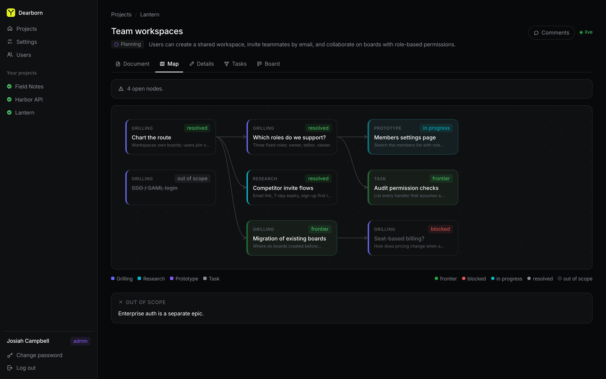
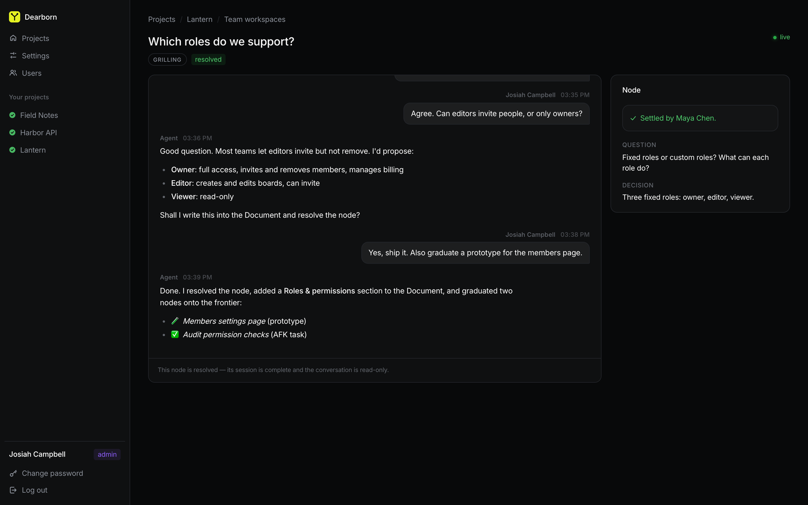
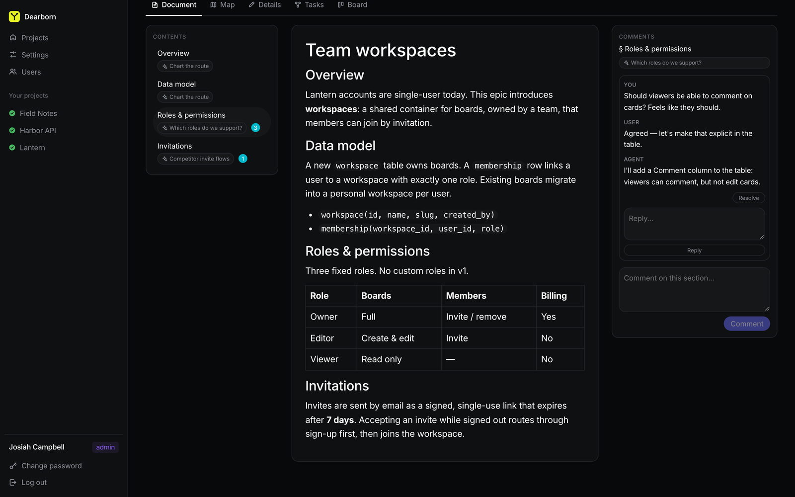
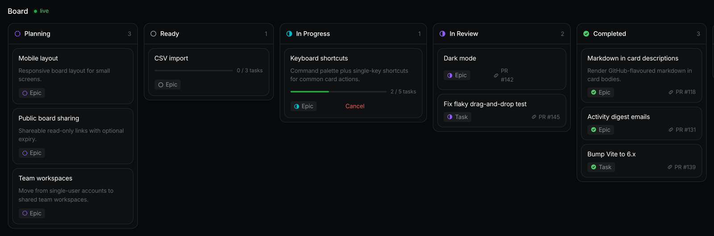
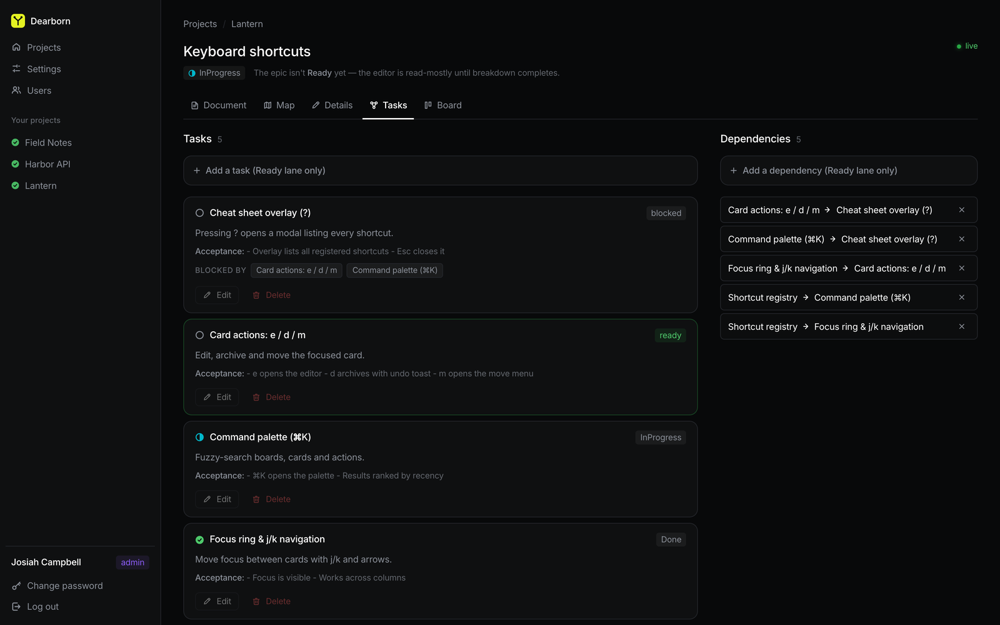
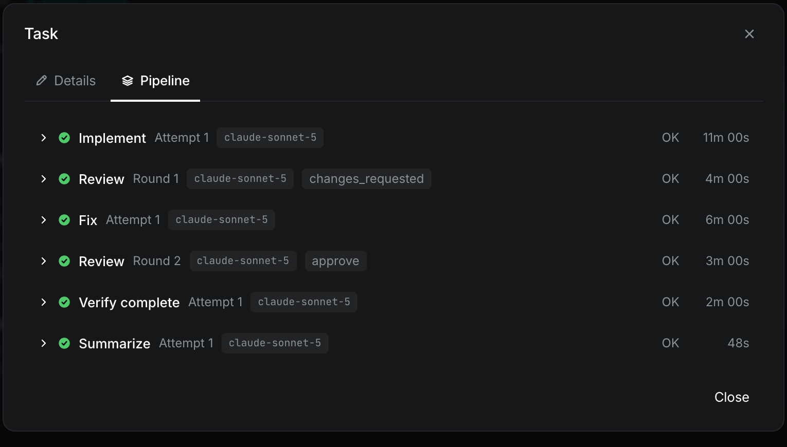
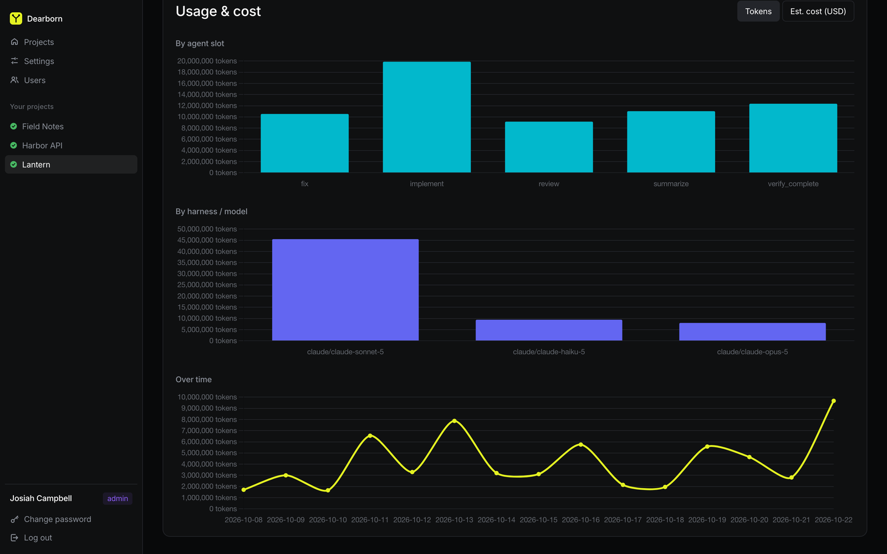

<div align="center">


# Dearborn

**Plan with your team. Ship with agents.**

A self-hosted Rust server that turns an idea into a reviewed pull request.
Chart the decisions with your team, then let coding agents build it.




</div>

---

## What is Dearborn?

Most "agent writes the code" tools start from a finished spec. Real work starts
earlier, with a vague goal and a pile of open questions. Dearborn covers the
whole path:

1. **Set a destination.** Create an epic and describe the end state in one sentence.
2. **Chart the route.** Dearborn seeds a **planning map** of decision nodes. You
   work through them one at a time with an agent and your teammates.
3. **Grow a living Document.** Each resolved node updates a shared spec. The
   spec records who decided what, and why.
4. **Break it down.** When nothing is left to decide, an agent turns the
   Document into a **task DAG**: small vertical slices with acceptance criteria.
5. **Execute.** A worker pool runs each task through
   `implement → test → commit → review → fix → verify`, then opens **one PR**
   for the epic.

You watch it all live on a kanban board, and you can step in at any point.

## Features

### 🗺️ Planning map

Big ideas break down into a graph of **decision nodes**. There are four kinds:

- **Grilling**: an agent interviews you until the decision is made.
- **Research**: an agent investigates a question on its own.
- **Prototype**: an agent builds a throwaway artifact you can look at in the browser.
- **Task**: AFK or hands-on work.

The map shows what is resolved, what is on the frontier, and what is blocked.
Resolving a node can add new questions to the frontier or rule things out of scope.

### 💬 Multiplayer node sessions

Each node has its own chat. Several people can talk with the agent in the same
thread. When the group agrees, the agent writes the decision into the Document
and resolves the node.

<p align="center">
  
</p>

### 📄 Living Document with comments

The settled decisions build up into one HTML spec per epic. Each section shows
which node wrote it. Comment threads attach to sections or nodes, the agent can
reply, and you can promote a thread into a new node on the map.

<p align="center">
  
</p>

### 📋 Kanban board for epics and tasks

Every epic and standalone task appears on a live board: Planning, Ready,
In Progress, In Review, and Completed. Cards show task progress and link to
their pull requests.

<p align="center">
  
</p>

### 🧩 Task DAG

Breakdown produces tasks with descriptions, acceptance criteria, and
dependency edges. Dearborn computes which tasks are ready to run. You can edit
tasks and dependencies before execution starts.

<p align="center">
  
</p>

### 🤖 Autonomous executor with review loops

Workers lease epics and run each task in its own git clone. Every stage
leaves evidence you can inspect: which model ran, how long it took, the review
verdict, and the log. Failed tests trigger a fix loop. A review that requests
changes triggers a fix round. A lost worker's lease expires, and another worker picks up the work.

<p align="center">
  
</p>

### 📊 Usage and cost tracking

Each project shows token use and estimated cost by agent stage, by
harness and model, and over time.

<p align="center">
  
</p>

### And more

- **Harness choice per agent slot.** Run every stage on
  [Claude Code](https://docs.anthropic.com/en/docs/claude-code), or run the
  task stages on [pi](https://pi.dev).
- **Multi-user.** Named accounts with admin and user roles. Every decision and
  edit records who made it.
- **Single binary.** The Rust server also serves the built Vue app. Data lives in a
  local libSQL file.
- **Your PATs stay safe.** GitHub tokens are encrypted at rest with
  AES-256-GCM. They never appear in API responses or logs.

## Quick start

You need [Rust](https://rustup.rs) (stable), [Node.js](https://nodejs.org) 20+,
and [`just`](https://github.com/casey/just) (`brew install just` or `cargo install just`).

```bash
git clone <this repo> && cd dearborn
cd client && npm install && cd ..
just dev
```

Open <http://localhost:5173>. A new instance asks you to create the first
admin account. After that, add a project (a Git repo URL, an optional GitHub
PAT, and your setup and test commands) and create your first epic.

> [!IMPORTANT]
> To run agent stages, the host must have **`git`** and a coding-agent CLI on
> its `PATH`. Use **`claude`** (logged in, or with `ANTHROPIC_API_KEY` set),
> and optionally **`pi`** for the task stages. Without them, the app still
> works, but any epic or task run fails at once.
> See [Agent harnesses](#agent-harnesses).

> [!WARNING]
> Whoever reaches a fresh instance first becomes its admin. Dearborn binds to
> `127.0.0.1` by default. If you expose it on a wider network, create your
> admin account right after you start it.

### Common commands

| Command      | What it does                                                                 |
| ------------ | ---------------------------------------------------------------------------- |
| `just dev`   | Runs the Rust server (`:8787`) and the Vite dev server (`:5173`) with hot reload |
| `just backend` | Runs the server only (reads `.env` if present; see `.env.example`)         |
| `just test`  | Runs the full test gate: `cargo test` + client tests. Fully hermetic.         |
| `just build` | Builds the release binary and the production SPA (`client/dist`)             |

In production, run the release binary with `DEARBORN_MASTER_KEY` set. The
binary serves the built SPA and the API from the same port. See
[docs/OPERATIONS.md](docs/OPERATIONS.md#configuration) for every setting.

## Agent harnesses

Every agent stage shells out to a coding-agent CLI in headless mode. You pick
the harness for each slot under **Settings → agent slots**.

| Harness | Binary | Runs | Notes |
| ------- | ------ | ---- | ----- |
| Claude Code (default) | `claude` | Every slot | Driven by the [`agent-harness`](https://github.com/getlatentic/agent-harness) crate. Must be logged in, or have `ANTHROPIC_API_KEY` set. |
| pi | `pi` | Task stages only (`implement`, `fix`, `review`, `verify_complete`, `summarize`, `triage`) | Driven by [`harness_pi.rs`](dearborn-server/src/harness_pi.rs). Needs a configured provider (`pi auth`). |

The planning-side slots (`grilling`, `prototype`, `research`, `afk_task`,
`breakdown`) run on Claude Code only for now. They call back into Dearborn
through the `dearborn` CLI to update the map and the Document. If you choose pi
for one of them, Dearborn rejects the setting with a 400.

Real agent stages spend real tokens. `just test` never calls either binary.
The `#[ignore]`d tests `dearborn-server/tests/worker_live.rs` and
`harness_pi_live.rs` exercise the real binaries when you run them on purpose
(`cargo test -- --ignored`).

## Repository layout

```
.
├── dearborn-server/      # Rust server crate (axum + tokio + libSQL)
│   ├── src/              # API, planning map, executor, harness adapters
│   ├── src/bin/          # `dearborn` CLI that agents use to talk back to the server
│   ├── migrations/       # SQL schema migrations
│   └── CONVENTIONS.md    # HTTP / WebSocket API contract
├── client/               # Vue 3 + TypeScript + Vite SPA (Pinia)
├── docs/                 # Operations guide and screenshots
├── matt-pocock-skills/   # Agent skills (e.g. wayfinder) used in planning
├── PLANNING_MAP_PRD.md   # Design of the planning map + living Document
└── justfile              # dev / test / build tasks
```

## Learn more

- **[docs/OPERATIONS.md](docs/OPERATIONS.md)**: configuration, authentication,
  the executor's worker and lease model, workspaces, recovery and cancellation,
  and secret handling.
- **[dearborn-server/CONVENTIONS.md](dearborn-server/CONVENTIONS.md)**: the REST and
  WebSocket API contract.
- **[PLANNING_MAP_PRD.md](PLANNING_MAP_PRD.md)**: the design behind the planning map
  and the living Document.
